<div align="center">

<a href="#readme">
  <picture>
    <source media="(prefers-color-scheme: dark)" srcset="docs/images/banner-dark.jpg">
    <source media="(prefers-color-scheme: light)" srcset="docs/images/banner-light.jpg">
    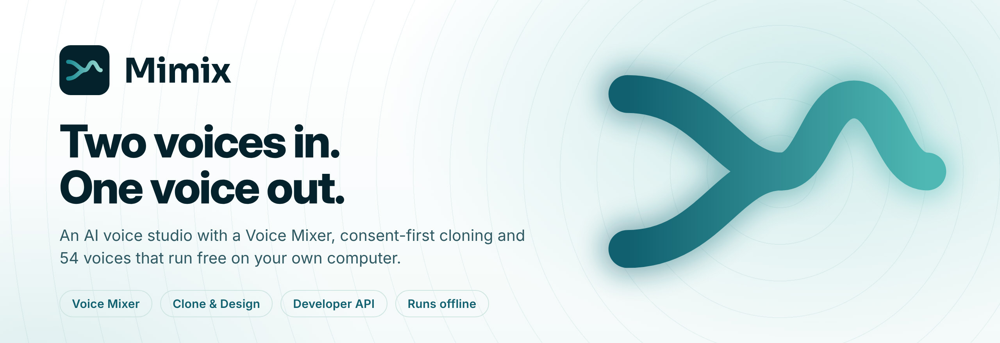
  </picture>
</a>

### The AI voice studio you can run on your own computer

Text to speech, a **Voice Mixer** that blends voices into brand-new ones, consent-first **voice cloning**, **voice design**, **dubbing**, **transcription** and a **developer API**.<br>
One Next.js app, real voices on your processor, and no accounts or keys to get started.

[](https://github.com/mechanicb0y/Mimix/actions/workflows/ci.yml)
[](CHANGELOG.md)
[](https://nextjs.org)
[](https://react.dev)
[](https://www.typescriptlang.org)
[](https://tailwindcss.com)
[](engines)
<br>
[](https://github.com/mechanicb0y/Mimix/actions/workflows/ci.yml)
[](docs/quality-report.md)
[](docs/quality-report.md)
[](docs/local-setup.md)
[](LICENSE)

[**Quick start**](#-quick-start) &nbsp;·&nbsp; [**Tour**](#-a-tour-of-the-app) &nbsp;·&nbsp; [**Voice Mixer**](#-the-voice-mixer) &nbsp;·&nbsp; [**API**](#-developer-api) &nbsp;·&nbsp; [**Architecture**](#-architecture) &nbsp;·&nbsp; [**Docs**](#-documentation)

<br>

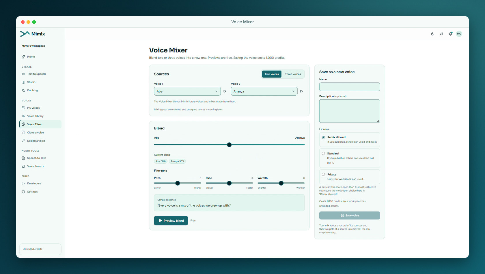

<sub>The Voice Mixer blending two library voices. Every screen in this README is Mimix 0.8.1 running on a Windows PC with the Kokoro engine.</sub>

</div>

<br>

> [!NOTE]
> **Status: 0.8.1, runs on your own computer today.** Hosting on Vercel, Supabase and Railway is prepared (see the [launch checklist](docs/launch-checklist.md)) but not live yet. A few parts are wired in but not yet tested on real hardware, and they are marked *untested* below.


## Contents

<table>
<tr>
<td valign="top" width="33%">

**Product**
- [Highlights](#-highlights)
- [A tour of the app](#-a-tour-of-the-app)
- [The Voice Mixer](#-the-voice-mixer)
- [Languages](#-languages)
- [Trust and safety](#-trust-and-safety)
- [Admin console](#-admin-console)
- [Plans and credits](#-plans-and-credits)

</td>
<td valign="top" width="33%">

**Run it**
- [Quick start](#-quick-start)
- [What works on your computer](#-what-works-on-your-computer)
- [Configuration](#-configuration)
- [Developer API](#-developer-api)
- [Architecture](#-architecture)

</td>
<td valign="top" width="33%">

**Project**
- [Quality](#-quality)
- [Brand and design system](#-brand-and-design-system)
- [Tech stack](#-tech-stack)
- [Project structure](#-project-structure)
- [Roadmap](#-roadmap)
- [Documentation](#-documentation)
- [Contributing](#-contributing) · [License](#-license)

</td>
</tr>
</table>

## ✨ Highlights

<table>
<tr>
<td width="33%" valign="top">

### 🔀 Voice Mixer
Blend two or three voices with a slider, then shape pitch, pace and warmth. Previews are free. A mix keeps a record of its sources and can never be more open than its most restrictive licence.

</td>
<td width="33%" valign="top">

### 🎧 Real voices, offline
Kokoro-82M runs on your processor: **54 voices in 8 languages**, with no account and no per-character bill. Speech to text, noise removal and cloning run on your computer too.

</td>
<td width="33%" valign="top">

### 🔐 Consent-first cloning
Clone a voice from 10 seconds of clear speech. Every clone has a consent record, a neural speaker check is built in, and every clip carries an "AI-generated with Mimix" label.

</td>
</tr>
<tr>
<td width="33%" valign="top">

### 🧩 One app, every piece
A marketing site, the app, an admin console and a public API in one Next.js 16 project. Each outside service has a local stand-in, so going to production is an environment change.

</td>
<td width="33%" valign="top">

### 🔌 Built for developers
**99 operations** under `/api/v1`, described in OpenAPI 3.1. API keys with scopes and credit caps, background jobs with live progress, and signed webhooks.

</td>
<td width="33%" valign="top">

### 🧪 Built to ship
**406 automated tests**, axe (WCAG 2.2 AA) on every page in both themes with zero violations, Lighthouse 90+ on mobile, an OWASP Top 10 review and strict security headers.

</td>
</tr>
</table>

## 📸 A tour of the app

### Text to Speech

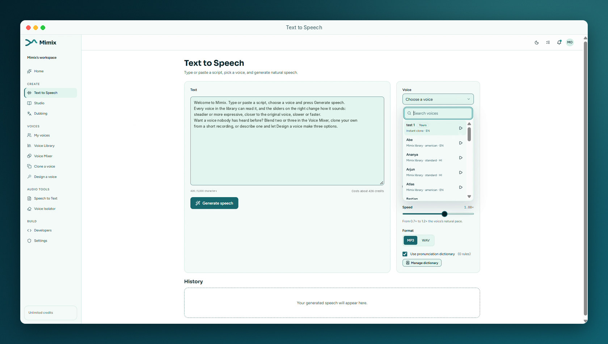

Type or paste up to 5,000 characters, pick any voice (library, cloned, designed or mixed) and tune **stability, similarity, style and speed**. Download MP3 or WAV, keep a pronunciation dictionary, and pay one credit per character. Speech is made by a background job, so it keeps going when you change page or close the tab; the **Jobs** menu shows progress and tells you when it's done.

### Every screen

<table>
<tr>
<td width="50%" valign="top">
<a href="docs/images/screens/app-library.jpg">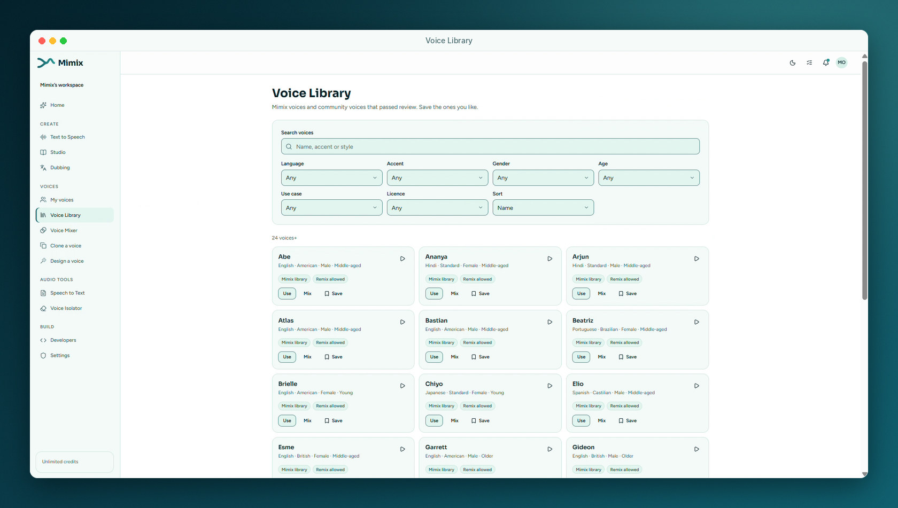</a>
<p><b>Voice Library</b><br>Mimix voices and community voices that passed review. Filter by language, accent, gender, age, use case and licence, then preview, use, save or mix any of them.</p>
</td>
<td width="50%" valign="top">
<a href="docs/images/screens/app-my-voices.jpg">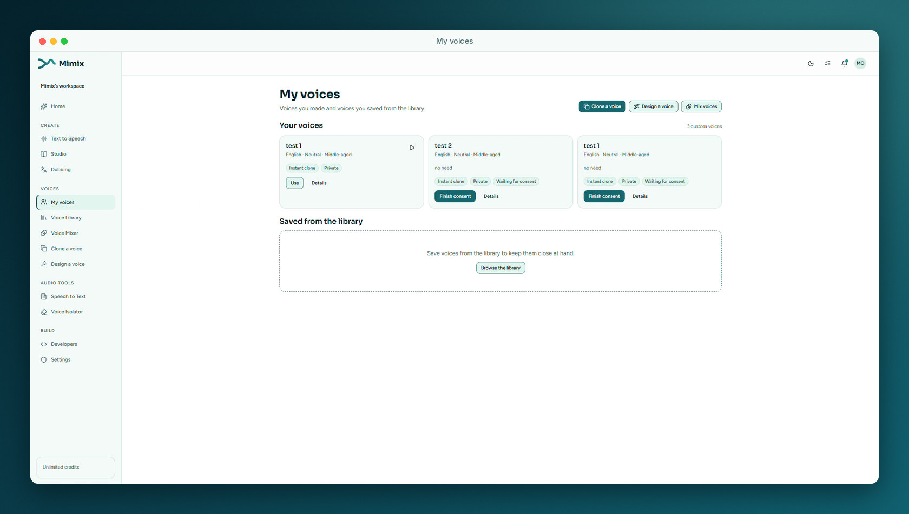</a>
<p><b>My voices</b><br>Your clones, designs and mixes in one place, with their status, plus the library voices you saved.</p>
</td>
</tr>
<tr>
<td width="50%" valign="top">
<a href="docs/images/screens/app-clone.jpg">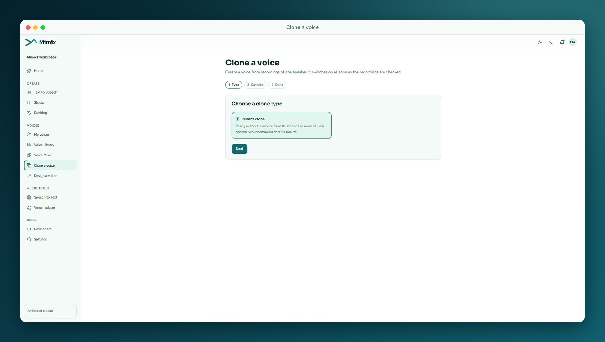</a>
<p><b>Clone a voice</b><br>Three steps: type, samples, done. An instant clone is ready in about a minute from 10 seconds or more of clear speech, with consent taken first (see <a href="#-trust-and-safety">Trust and safety</a>).</p>
</td>
<td width="50%" valign="top">
<a href="docs/images/screens/app-design.jpg">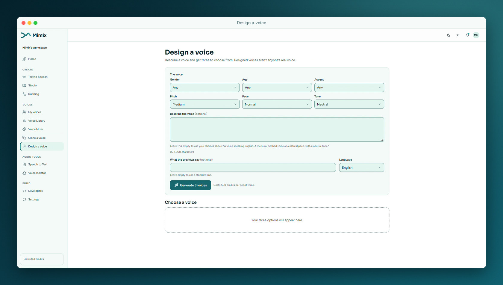</a>
<p><b>Design a voice</b><br>Describe a voice and choose gender, age, accent, pitch, pace and tone; Mimix makes three options to preview. Designed voices aren't anyone's real voice.</p>
</td>
</tr>
<tr>
<td width="50%" valign="top">
<a href="docs/images/screens/app-studio.jpg">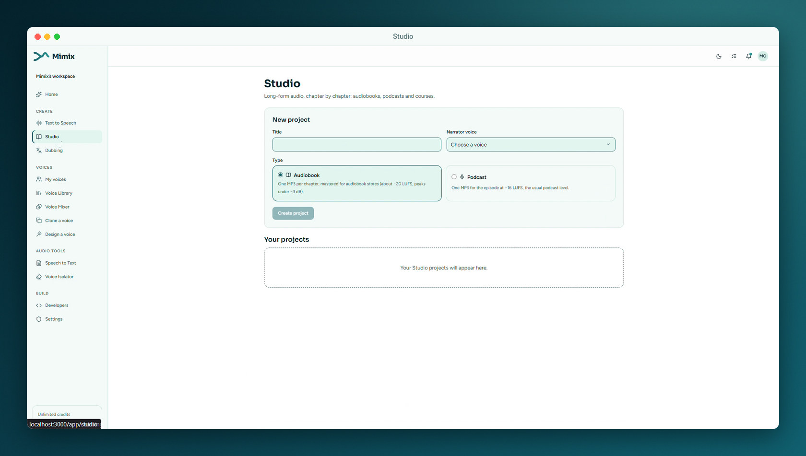</a>
<p><b>Studio</b><br>Long-form audio for audiobooks and podcasts. Import text or Markdown into chapters and blocks, give each speaker a voice, and export mastered MP3s.</p>
</td>
<td width="50%" valign="top">
<a href="docs/images/screens/app-dubbing.jpg">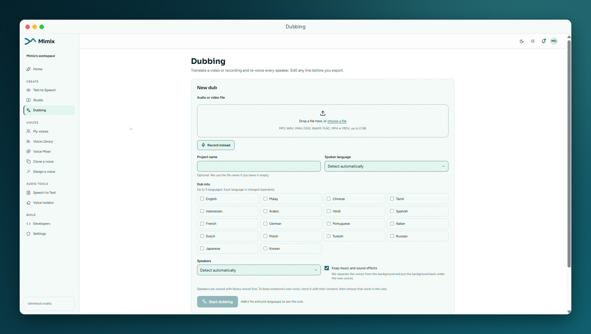</a>
<p><b>Dubbing</b><br>Upload audio or video and dub it into up to five languages. Edit lines, recast voices, re-voice only what changed, and download SRT or VTT captions.</p>
</td>
</tr>
<tr>
<td width="50%" valign="top">
<a href="docs/images/screens/app-stt.jpg">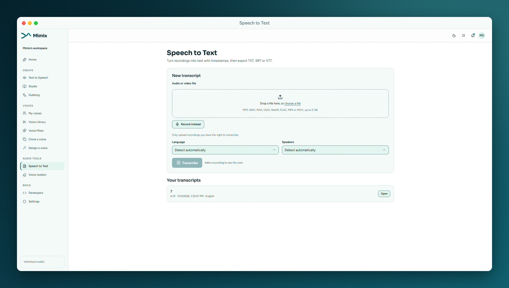</a>
<p><b>Speech to Text</b><br>Transcripts with timestamps, exported as TXT, SRT or VTT. Runs on faster-whisper on your processor.</p>
</td>
<td width="50%" valign="top">
<a href="docs/images/screens/app-isolator.jpg">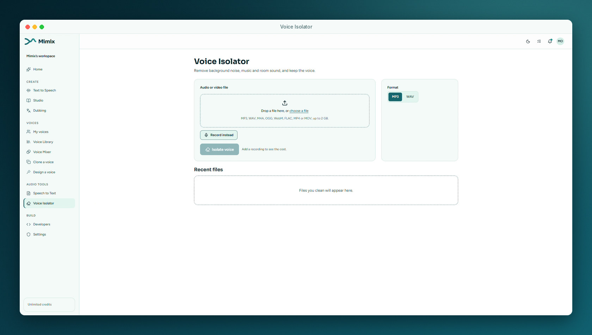</a>
<p><b>Voice Isolator</b><br>Removes background noise and music from a recording with DeepFilterNet. In testing, a noisy clip went from 7 dB to 15 dB signal-to-noise.</p>
</td>
</tr>
<tr>
<td width="50%" valign="top">
<a href="docs/images/screens/app-developers.jpg">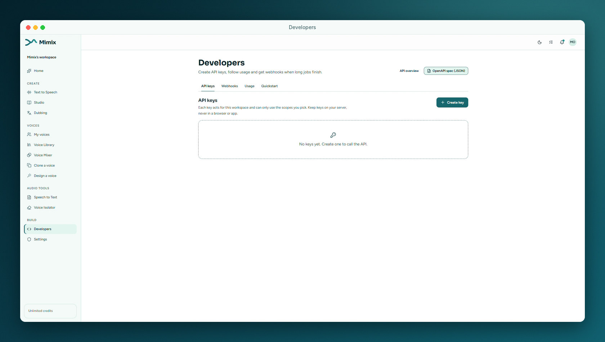</a>
<p><b>Developers</b><br>API keys with scopes and monthly credit caps, webhooks with signed deliveries, and usage by day, product and key.</p>
</td>
<td width="50%" valign="top">
<a href="docs/images/screens/app-settings.jpg">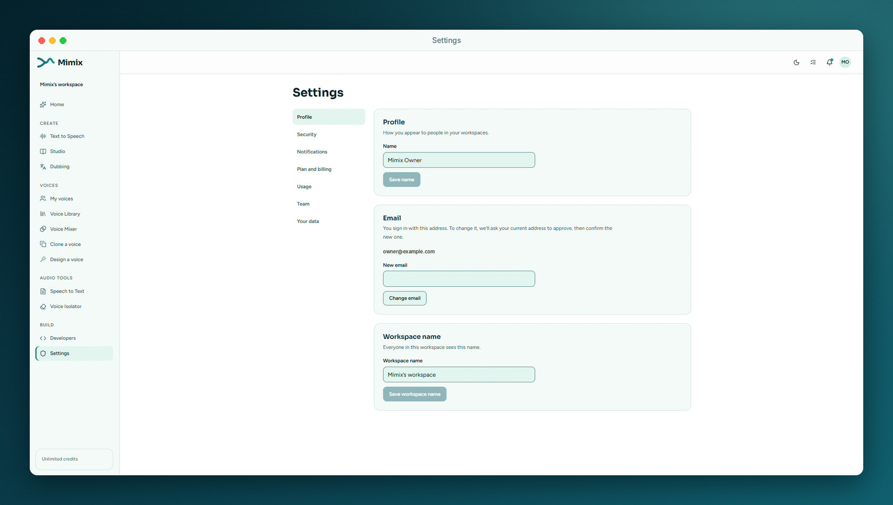</a>
<p><b>Settings</b><br>Profile, security with two-factor sign-in, notifications, plan and billing, usage, team members and your data.</p>
</td>
</tr>
<tr>
<td width="50%" valign="top">
<a href="docs/images/screens/app-app-home.jpg">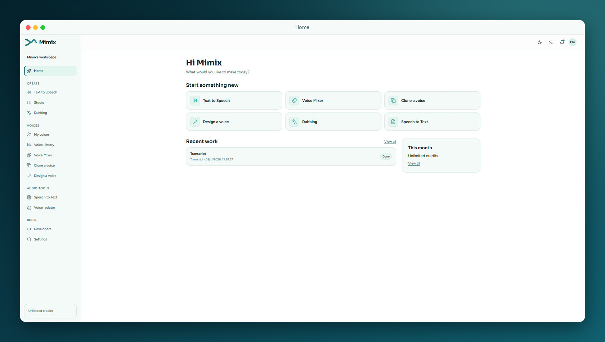</a>
<p><b>Home</b><br>Start something new in one click, pick up recent work and see this month's credits.</p>
</td>
<td width="50%" valign="top">
<a href="docs/images/screens/app-site-home.jpg">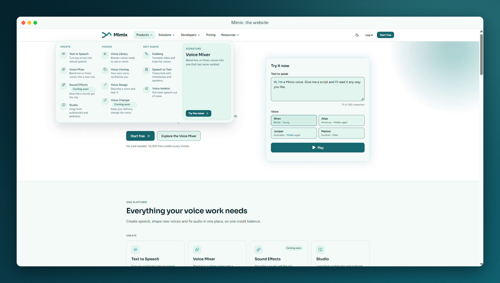</a>
<p><b>The website</b><br>Product pages, pricing, use cases, a public voice library, a developer page, a blog, help and legal pages, and a live "Try it now" box.</p>
</td>
</tr>
</table>

<details>
<summary><b>More screens</b>: the products overview and Text to Speech without the voice picker</summary>
<br>
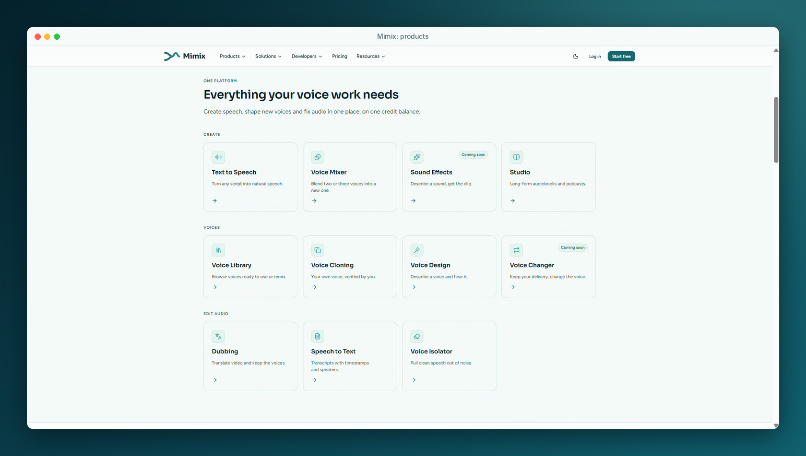
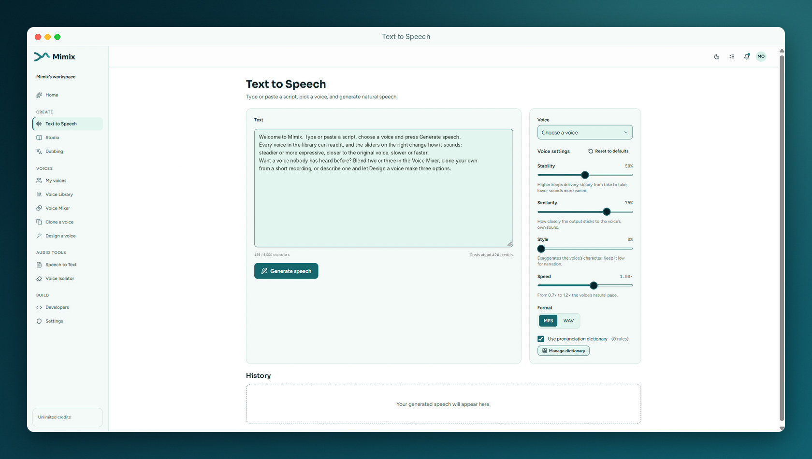
</details>

## 🔀 The Voice Mixer

Mimix's signature tool. Pick two or three voices, set the blend with a slider, fine-tune **pitch, pace and warmth**, and preview the result on a sample sentence for free. Saving it makes a new voice you can use everywhere: Text to Speech, Studio, Dubbing and the API.

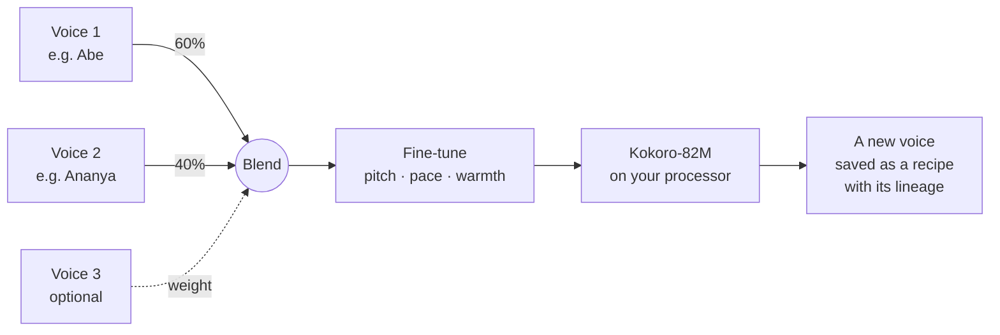

- **Recipes, not recordings.** A mix is saved as its sources and their weights, so it is small and repeatable. If a source is removed, the mix stops working.
- **Licences carry over.** Every voice is *Remix allowed*, *Standard* or *Private*, and a mix can't be more open than its most restrictive source.
- **Lineage you can query.** `GET /api/v1/voices/{id}` returns where a voice came from.
- **Plans.** The Free plan mixes two voices, paid plans mix three. Previews are free; saving a voice costs 1,000 credits.
- **Mix, then clone** (`MIX_CLONE_TO_MAIN`, off by default). A saved mix can be copied onto a main engine that clones from about 30 seconds of system-made speech, after a lineage check confirms that no person's recorded voice is involved.

## 🚀 Quick start

### On your own computer: no terminal, no administrator password

| You need | |
|---|---|
| **System** | Windows 10 or 11 (64-bit), macOS 14 or newer, or Linux (x86-64) |
| **Memory and disk** | 8 GB of memory (16 GB is more comfortable) and about 8 GB of free disk space |
| **First start** | 15 to 30 minutes. It downloads about 2.5 GB, then Mimix runs without the internet |
| **Graphics card** | Optional: an NVIDIA card with 8 GB or more for the extra GPU engines |

1. **Get the code.** In GitHub Desktop choose *File → Clone repository → URL* and paste `https://github.com/mechanicb0y/Mimix`, or click **Code → Download ZIP** on this page and unzip it.
2. **Start it.** Double-click **`Start Mimix.cmd`** on Windows. On a Mac, Control-click **`Start Mimix.command`** and choose *Open*. On Linux, run `bash "Start Mimix.command"`.
3. **Wait for "Mimix is running".** Your browser opens **http://localhost:3000**.
4. **Create the Owner account** at **http://localhost:3000/admin/setup** with the `ADMIN_SETUP_TOKEN` from the new `.env.local` file, then turn on two-factor sign-in.
5. **Stop it** by closing the window or double-clicking **Stop Mimix**.

The tools the launcher sets up (a private Node.js, Python 3.12, Kokoro and its models, DeepFilterNet and stripe-mock) go into the project's `local/` folder, your data (database, audio, emails) into `.data/`, and every download is checked against a pinned SHA-256. Nothing is installed on the system. The Owner account uses `owner@example.com` unless `MIMIX_OWNER_EMAIL` is set before the first start; you can change it any time in *Settings → Profile*.

📖 **Step-by-step guide, with common problems:** [docs/local-setup.md](docs/local-setup.md)

### For developers

```bash
git clone https://github.com/mechanicb0y/Mimix.git
cd Mimix
npm install
cp .env.example .env.local   # optional: empty values mean "use the local stand-in"
npm run db                   # Postgres (PGlite) on 127.0.0.1:5433; keep it running
npm run db:migrate           # create the tables
npm run dev                  # http://localhost:3000
```

Needs Node.js 22 or newer. With the defaults the voice engine is the **mock engine** (voice-like sound, no words), so every flow works without Python. For real voices, use the launcher above or run [`engines/kokoro`](engines/kokoro/README.md) and set `VOICE_ENGINE=kokoro`. Scripts, engines and the folder layout are in [docs/development.md](docs/development.md).

## 💻 What works on your computer

| Feature | Status | Notes |
|---|:---:|---|
| Website, sign-up, sign-in, settings, team | ✅ | |
| Text to Speech and Studio | ✅ | Real Kokoro voices: 54 voices in 8 languages |
| Voice Mixer | ✅ | Blend library and Kokoro voices; mixing your own clones comes later |
| Voice cloning | ✅ | Instant clones with OpenVoice v2. Locally your ticked confirmation is the consent (`CLONE_CONSENT=attest`) |
| Voice Design | ✅ | Three Kokoro blends from your description and choices |
| Speech to Text | ✅ | faster-whisper on the processor. Every line is labelled "Speaker 1" for now |
| Voice Isolator | ✅ | DeepFilterNet |
| Developer API and keys | ✅ | `http://localhost:3000/api/v1` |
| Admin console | ✅ | Needs an authenticator app for two-factor sign-in |
| Dubbing | 🟡 | Transcribes and re-voices; real translation needs a Google Cloud Translation key |
| Plans and billing | 🟡 | Pages work against stripe-mock; no real payments |
| Email | 🟡 | Shown in the Mimix window and saved in `.data/outbox` |
| GPU engines (VoxCPM2, Chatterbox) | 🧪 | Wired in, offered when an NVIDIA card is found; *untested* |
| Voice Changer, Sound Effects | ⏸️ | Need engines that aren't wired in yet |
| Continue with Google | ⏸️ | Needs a Google sign-in client ID and secret |

## 🌍 Languages

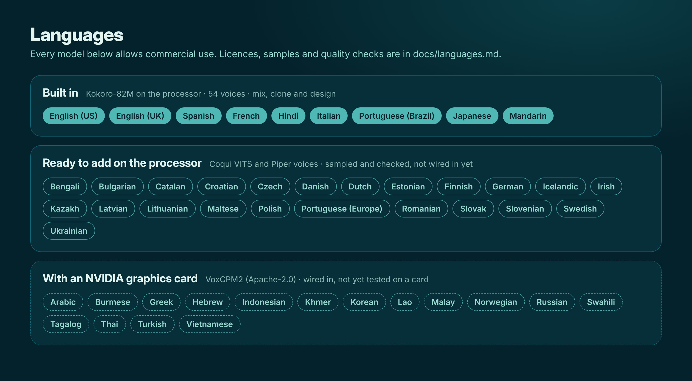

| Route | Runs on | Languages | In Mimix 0.8 |
|---|---|---|---|
| **Kokoro-82M**, 54 voices | Processor | **8**: English (US, UK), Spanish, French, Hindi, Italian, Brazilian Portuguese, Japanese, Mandarin | Built in |
| **Coqui VITS** and **Piper** voices in sherpa-onnx | Processor | **+22**, from Bengali and Dutch to Swedish and Ukrainian | Sampled, not wired in yet |
| **VoxCPM2** (OpenBMB) | NVIDIA card, 8 to 10 GB | **30**, of which 16 are new, including Arabic, Korean, Malay, Russian, Thai, Turkish and Vietnamese | Wired in, *untested* |
| **Chatterbox Multilingual** (Resemble AI) | NVIDIA card, about 8 GB | **23** | Wired in, *untested* |

That makes **30 languages on a processor** and **46 with VoxCPM2** on a graphics card, every route checked for a licence that allows commercial use. The research, licences and 80 samples checked with Whisper are in [docs/languages.md](docs/languages.md). The interface itself is ready for translation: every string lives in `src/i18n/messages/en` and `src/content/en`.

## 🔐 Trust and safety

- **Consent for every clone.** `CLONE_CONSENT=recording` (the default for a public site) asks the speaker to read a random phrase that must match the samples in both words and voice. `attest` (used on your own computer) takes the uploader's confirmation that they are the speaker or have written permission. Either way Mimix keeps a consent record with the time and IP address, and writes it to the audit log.
- **A neural speaker check.** 3D-Speaker's CAM++ model compares voices; *Tune voice check* sets its pass mark from your own recordings.
- **Provenance.** Every clip carries an "AI-generated with Mimix" label in its file, and Mimix keeps a fingerprint of the exact audio. Anyone can check a clip at `/check-audio` without learning who made it.
- **Reports and takedowns.** Anyone can report a voice or clip at `/report`; moderators review it in the console, and a voice that was taken down stays refused.
- **Moderated publishing.** Publishing a voice to the library goes through review. Designed voices aren't anyone's real voice, and a mix is checked for recorded voices before it can be cloned.

## 👥 Admin console

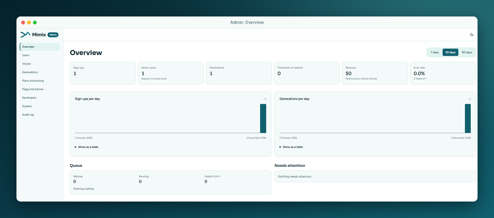

<table>
<tr>
<td width="50%" valign="top">
<a href="docs/images/screens/admin-system.jpg">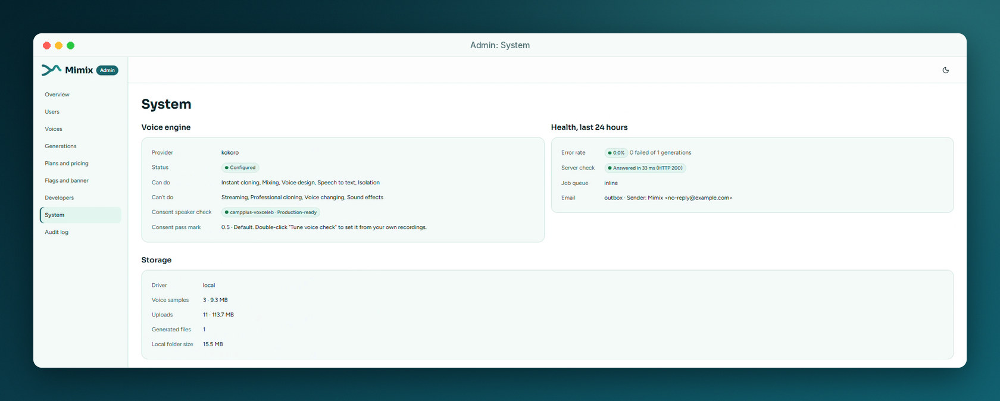</a>
<p><b>System</b><br>The active voice engine and what it can do, the consent check, health over the last 24 hours, storage and every email template.</p>
</td>
<td width="50%" valign="top">
<a href="docs/images/screens/admin-audit.jpg">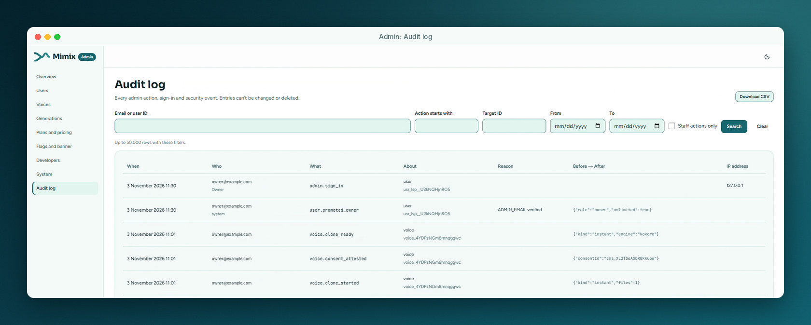</a>
<p><b>Audit log</b><br>Every admin action, sign-in and security event, with before and after values. Entries can't be changed or deleted; export to CSV.</p>
</td>
</tr>
<tr>
<td width="50%" valign="top">
<a href="docs/images/screens/admin-flags.jpg">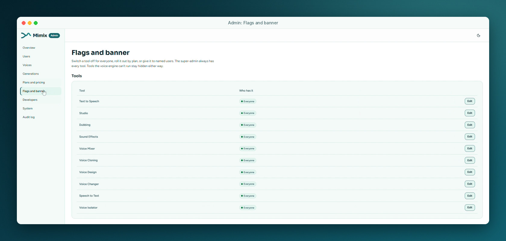</a>
<p><b>Flags and banner</b><br>Switch a tool off for everyone, roll it out by plan or give it to named users. Plus a site banner and a maintenance mode.</p>
</td>
<td width="50%" valign="top">
<a href="docs/images/screens/admin-plans.jpg">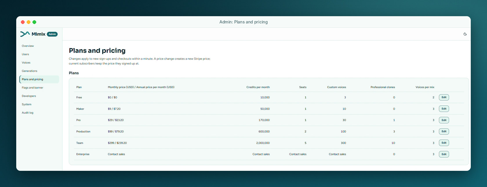</a>
<p><b>Plans and pricing</b><br>Edit prices and limits; a change creates a new Stripe price and current subscribers keep theirs. Coupons too.</p>
</td>
</tr>
</table>

| Role | Can |
|---|---|
| **Owner** | Everything, including staff roles. The Owner's workspace gets every feature with no limits and no Stripe |
| **Admin** | Runs the platform: users, plans, flags, banners; can't change roles |
| **Moderator** | Voices, reports and suspensions |
| **Support** | Users, credits, two-factor resets and *view as user* |

Staff must use two-factor sign-in. The console locks after 15 idle minutes, asks for the password and a code again before anything destructive, can be limited to listed IP addresses (`ADMIN_IP_ALLOWLIST`), and every staff change takes a reason that goes into the audit log. Staff can also give any workspace a plan for free, for testers. More in the [admin guide](docs/admin-guide.md).

## 🔌 Developer API

Create a key in **Developers → API keys** (it is shown once), then:

```bash
export MIMIX_API_KEY="mmx_..."

# The voices your workspace can use
curl -s http://localhost:3000/api/v1/voices \
  -H "Authorization: Bearer $MIMIX_API_KEY"

# Generate speech (201: the generation, with signed audio URLs)
curl -s http://localhost:3000/api/v1/text-to-speech \
  -H "Authorization: Bearer $MIMIX_API_KEY" \
  -H "Content-Type: application/json" \
  -d '{
        "text": "Two voices in. One voice out.",
        "voiceId": "VOICE_ID",
        "settings": { "stability": 0.5, "similarity": 0.75, "style": 0, "speed": 1 },
        "format": "mp3"
      }'
```

| Group | What's in it |
|---|---|
| **Speech** | `POST /text-to-speech` (one take), `/text-to-speech/async` (a job), `/text-to-speech/stream` (chunked MP3), pronunciation rules, history |
| **Voices** | Your voices, library search, lineage, previews, mix preview and save, design, cloning with consent, publishing |
| **Audio** | Speech to text (JSON, TXT, SRT or VTT), voice isolator, voice changer, sound effects |
| **Dubbing** | Projects in up to five languages, line edits, re-rendering, SRT and VTT captions |
| **Studio** | Audiobook and podcast projects, chapters, blocks and mastered MP3 exports |
| **Jobs** | Status, cancel with a refund, and live progress as server-sent events |
| **Account and developers** | Usage, the credit ledger, keys, webhooks and notifications |

- **Auth:** `Authorization: Bearer mmx_…` or `x-api-key: mmx_…`. Keys carry scopes (`tts`, `voices:read`, `voices:write`, `stt`, `sfx`, `isolator`, `changer`, `dubbing`, `studio`, `usage:read`) and an optional monthly credit cap.
- **Honest errors:** a tool the current engine can't run answers `501 engine_unsupported` before any credits are charged.
- **Reference:** [docs/openapi.json](docs/openapi.json) (OpenAPI 3.1), also served at `/api/v1/openapi.json`.

<details>
<summary><b>Webhooks</b>: events and verifying the signature</summary>

Events: `job.succeeded`, `job.failed`, `voice.ready`, `voice.taken_down` and `credits.low`. Each delivery has the headers `Mimix-Event`, `Mimix-Delivery` and `Mimix-Signature: t=<unix seconds>,v1=<hex>`, where `v1` is HMAC-SHA256 of `"<t>.<raw body>"` with your endpoint's signing secret.

```js
import { createHmac, timingSafeEqual } from 'node:crypto'

export function verifyMimixSignature(secret, rawBody, header, toleranceSeconds = 300) {
  const parts = Object.fromEntries(header.split(',').map((p) => p.split('=')))
  const t = Number(parts.t)
  if (!Number.isFinite(t) || Math.abs(Date.now() / 1000 - t) > toleranceSeconds || !parts.v1) return false
  const expected = Buffer.from(createHmac('sha256', secret).update(`${t}.${rawBody}`).digest('hex'))
  const got = Buffer.from(parts.v1)
  return expected.length === got.length && timingSafeEqual(expected, got)
}
```

Reject anything older than five minutes. You can send a signed test event, rotate the secret and see recent deliveries from **Developers → Webhooks**.
</details>

## 🧱 Architecture

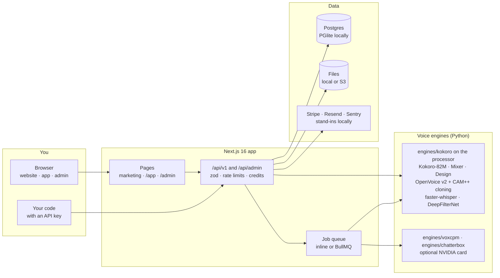

Every outside service sits behind an interface with a local stand-in. Switching to the real service is an environment change, never a code change:

| Concern | On your computer (default) | In production |
|---|---|---|
| Database | PGlite (Postgres in WebAssembly) on port 5433 | Supabase Postgres |
| Auth | Better Auth on Mimix's own tables | The same, with a real secret and optional Google sign-in |
| File storage | Files in `.data/storage` with signed URLs | Supabase Storage (S3 API) or Cloudflare R2, optional CDN |
| Billing | stripe-mock | Stripe, with Checkout, the customer portal and signed webhooks |
| Email | JSON files in `.data/outbox`, shown in the Mimix window | Resend |
| Jobs | Inline, in the web process | BullMQ on Redis with `npm run worker` |
| Voice engine | Kokoro on the processor (mock engine without Python) | Kokoro, the VoxCPM2 GPU server or Inworld (*untested*) |
| Error monitoring | Console only | Sentry |
| Dubbing translation | A stand-in that tags each line | Google Cloud Translation |

Each engine declares what it can do. Tools an engine can't run are hidden in the app and refused by the API, and engine-dependent limits stay off the site until they are confirmed against the engine. The production layout (Vercel, Supabase, Railway) is drawn in [docs/architecture.md](docs/architecture.md).

## 💳 Plans and credits

| Plan | Monthly | Yearly, per month | Credits a month | Seats | Custom voices | Voices per mix |
|---|---:|---:|---:|---:|---:|---:|
| Free | $0 | $0 | 10,000 | 1 | 3 | 2 |
| Maker | $9 | $7.20 | 50,000 | 1 | 10 | 3 |
| **Pro** | **$29** | **$23.20** | **170,000** | 1 | 30 | 3 |
| Production | $99 | $79.20 | 600,000 | 2 | 100 | 3 |
| Team | $299 | $239.20 | 2,000,000 | 5 | 300 | 3 |
| Enterprise | Contact sales | | | | | 3 |

One credit per character of speech. Top-ups: 50,000 credits for $12, 250,000 for $50 and 1,000,000 for $180. Paid plans include commercial use. Prices live in [`src/config/plans.ts`](src/config/plans.ts) and can be changed from the console. On your own computer the Owner gets every feature, with no Stripe needed.

## 🔧 Configuration

[`.env.example`](.env.example) lists every variable with its default, and `src/server/env.ts` checks them at start-up (in production the app refuses to start with a development secret). The launcher writes a ready `.env.local` for you. The ones you are most likely to touch:

| Variable | Default | What it does |
|---|---|---|
| `VOICE_ENGINE` | `mock` | Main engine: `mock`, `kokoro`, `voxcpm` or `inworld` |
| `KOKORO_FEATURES` | | Extras on the Kokoro server: `transcribe`, `isolate`, `clone` |
| `MIXER_ENGINE` | `none` | `kokoro` blends voices on the Kokoro server |
| `CLONE_CONSENT` | `recording` | `recording` (read-aloud check) or `attest` (ticked confirmation) |
| `SPEAKER_VERIFIER` | `dsp` | `neural` uses 3D-Speaker CAM++ on the Kokoro server |
| `GPU_ENGINE` | `off` | `chatterbox` or `voxcpm` on an NVIDIA card |
| `QUEUE_DRIVER` | `inline` | `bullmq` for Redis plus `npm run worker` |
| `STORAGE_DRIVER` | `local` | `s3` for Supabase Storage or R2 |
| `EMAIL_DRIVER` | `outbox` | `resend` |
| `STRIPE_API_BASE` | | `http://localhost:12111` for stripe-mock |
| `TRANSLATOR` | `mock` | `google` for Cloud Translation |

## 🧪 Quality

| Check | Result |
|---|---|
| Unit and integration tests (Vitest, real Postgres in PGlite, stripe-mock) | **271 passing**, 4 skipped in CI (they need a live Kokoro server or a running stripe-mock) |
| Browser tests (Playwright, production build) | **135 passing**: sign-up to download, a Stripe upgrade with a signed webhook, cloning with consent, mixing, an admin credit change |
| Accessibility | axe (WCAG 2.2 AA rules) on every public page, app page and console section, light and dark: **zero violations** |
| Layout | Every page at 375 to 1920 px: no sideways scrolling, 24 px minimum targets, 44 px on touch screens |
| Keyboard | Tab through every page: every control reachable, visible focus, no traps |
| Performance | Lighthouse on a simulated slow phone: 90 to 96 on public pages, accessibility, best practices and SEO 100, layout shift 0 |
| Security | [OWASP Top 10 review](docs/security-review.md), Content-Security-Policy, HSTS, COOP, origin checks on cookie writes, encrypted webhook secrets, rate limits |
| CI | Lint, type check, unit tests, build, `npm audit` and the browser suite on every push |

Test counts are from the [CI run on GitHub](https://github.com/mechanicb0y/Mimix/actions/workflows/ci.yml); accessibility and performance results are from the [quality report](docs/quality-report.md). Automated accessibility checks are not a full audit; a manual audit is on the roadmap.

## 🎨 Brand and design system

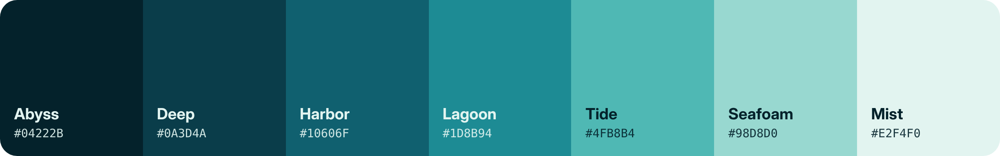

The **Holst** palette runs from deep Abyss to pale Mist, and the **Fork** mark shows two voices merging into one. It won against five other concepts scored on the brief:

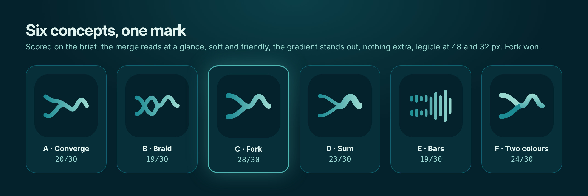

<table>
<tr>
<td width="50%">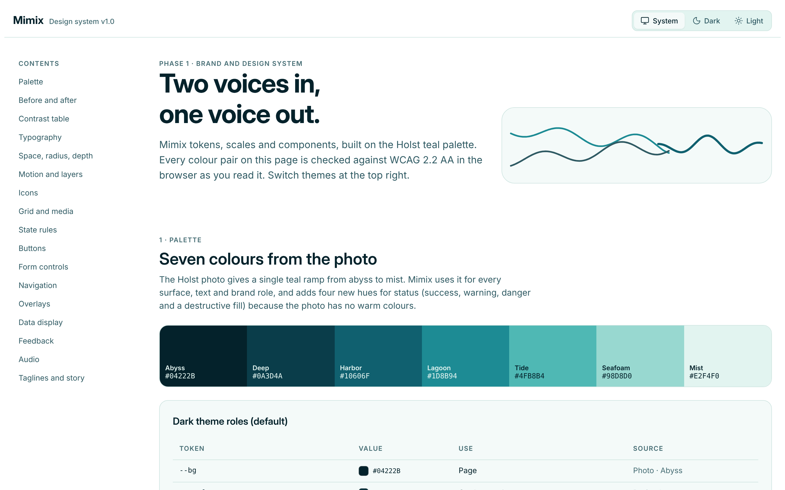</td>
<td width="50%">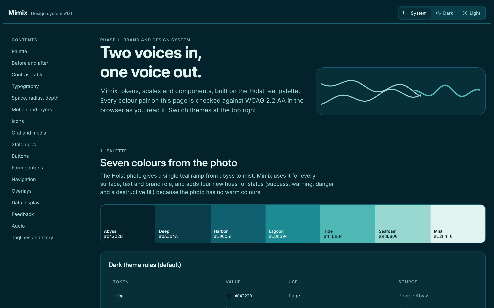</td>
</tr>
</table>

<details>
<summary><b>Components, overlays and audio</b> from the style guide</summary>
<br>
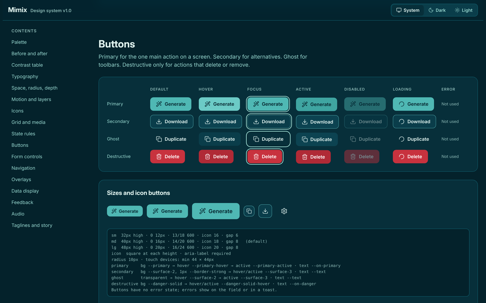
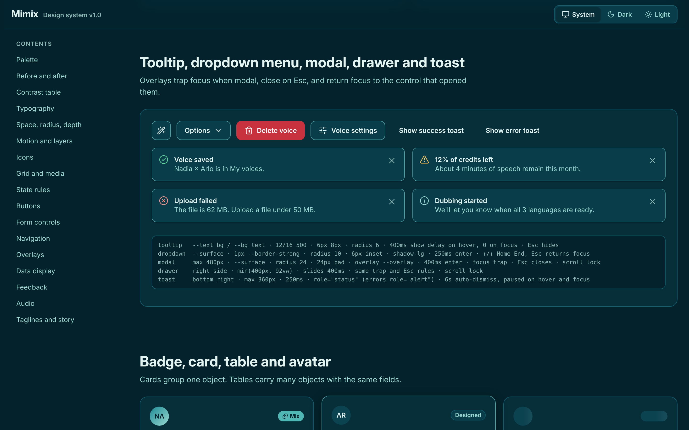
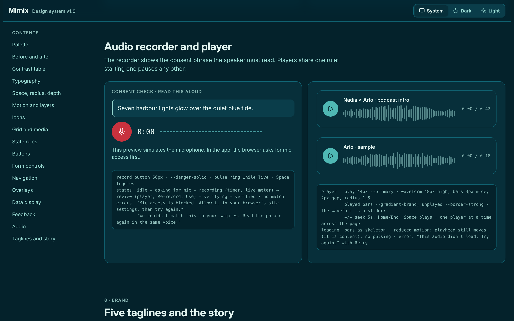
</details>

Design tokens (color, type, spacing, radius, motion) are in [`src/styles/tokens.css`](src/styles/tokens.css); the style guide, contrast checks and a Tailwind theme are in [`docs/design-system`](docs/design-system/README.md); app icons for the web, iOS and Android are in [`docs/brand`](docs/brand).

## 🧰 Tech stack

| Layer | Tools |
|---|---|
| App | [Next.js](https://nextjs.org) 16.4 (App Router), [React](https://react.dev) 19.3, [TypeScript](https://www.typescriptlang.org) 6.0 |
| Interface | [Tailwind CSS](https://tailwindcss.com) 4.3, [Radix UI](https://www.radix-ui.com), [Lucide](https://lucide.dev) icons, [wavesurfer.js](https://wavesurfer.xyz) 8, TanStack Query |
| Data | [Drizzle ORM](https://orm.drizzle.team), PostgreSQL ([PGlite](https://pglite.dev) locally, Supabase in production), S3-compatible storage |
| Auth | [Better Auth](https://www.better-auth.com): email and password, two-factor sign-in, optional Google |
| Validation | [zod](https://zod.dev) 4, shared by the interface and the API |
| Jobs | [BullMQ](https://bullmq.io) on Redis, or inline |
| Payments and email | [Stripe](https://stripe.com) (stripe-mock locally), [Resend](https://resend.com) |
| Voice engines | Python 3.12 and FastAPI: Kokoro-82M (ONNX), OpenVoice v2, 3D-Speaker CAM++ in sherpa-onnx, faster-whisper, DeepFilterNet; VoxCPM2 and Chatterbox on a GPU |
| Audio | ffmpeg (bundled through ffmpeg-static) |
| Monitoring | [Sentry](https://sentry.io) |
| Testing | [Vitest](https://vitest.dev) 5, [Playwright](https://playwright.dev) 1.63, [axe-core](https://github.com/dequelabs/axe-core) 4.14 |
| Delivery | GitHub Actions, Vercel, Railway (worker image), Supabase |

## 📁 Project structure

```text
Mimix/
├── Start Mimix.cmd / .command    one-click start for Windows / Mac (and Linux with bash)
├── Stop Mimix.cmd / .command     stop everything
├── Tune voice check.cmd / .command
├── src/
│   ├── app/(marketing)/          public site, including /report and /check-audio
│   ├── app/(auth)/               sign-up, sign-in, two-factor, reset, verify, invite
│   ├── app/app/                  the signed-in app
│   ├── app/admin/                the staff console
│   ├── app/api/v1/               the public API (OpenAPI at /api/v1/openapi.json)
│   ├── app/api/admin/            console actions
│   ├── components/               interface by module
│   ├── config/                   plans, credits, engine limits, voices, navigation
│   ├── i18n/messages/en/         every interface string and email
│   ├── lib/voice/                the VoiceEngine interface and its adapters
│   ├── lib/schemas/              zod schemas shared by the interface and the API
│   └── server/                   database, auth, API helpers, jobs, storage, email, billing
├── engines/
│   ├── kokoro/                   Kokoro-82M server: speech, Mixer, Design, cloning, STT, isolation
│   ├── voxcpm/                   VoxCPM2 GPU server
│   └── chatterbox/               Chatterbox Multilingual GPU server
├── scripts/                      database, migrations, worker, Stripe setup, the local launcher
├── drizzle/                      SQL migrations
├── tests/                        unit, integration and e2e (Playwright)
├── docs/                         guides, OpenAPI, brand, design system, images
└── .github/workflows/            CI, uptime check, nightly backup, one-off setup
```

## 🧭 Roadmap

- [x] Text to Speech, Studio, Dubbing, Speech to Text and the Voice Isolator
- [x] Voice Mixer on Kokoro: two or three voices, pitch, pace and warmth
- [x] Instant cloning on the processor with a consent check
- [x] Voice Design from a description
- [x] Admin console, API keys, webhooks and OpenAPI
- [x] One-click start for Windows, macOS and Linux
- [ ] Mix your own cloned and designed voices in the Mixer
- [ ] Wire in the 22 extra processor languages (sherpa-onnx)
- [ ] Test the GPU engines, VoxCPM2 and Chatterbox, on a real NVIDIA card
- [ ] Engines for the Voice Changer and Sound Effects
- [ ] Tell speakers apart in Speech to Text
- [ ] A manual accessibility audit, and a legal review of consent by confirmation
- [ ] Hosted launch on Vercel, Supabase and Railway

## 📚 Documentation

| Guide | What's inside |
|---|---|
| [Local setup](docs/local-setup.md) | Run Mimix on your own computer, step by step, plus common problems |
| [Development](docs/development.md) | Developer setup, scripts, voice engines and the folder layout |
| [Architecture](docs/architecture.md) | How the parts fit in production, with a diagram |
| [Languages](docs/languages.md) | The free routes to about 50 languages, licences and samples |
| [Admin guide](docs/admin-guide.md) | The staff console, roles and common tasks |
| [Launch checklist](docs/launch-checklist.md) | Hosting on GitHub, Supabase, Stripe, Railway and Vercel, with every variable |
| [Runbook](docs/runbook.md) | Deploys, rollbacks, backups and incidents |
| [Security review](docs/security-review.md) | OWASP Top 10 review and the risks that remain |
| [Quality report](docs/quality-report.md) | Tests, accessibility and performance results |
| [API reference](docs/openapi.json) | OpenAPI 3.1 |
| [Design system](docs/design-system/README.md) | Tokens, contrast checks and the style guide |
| [Engines](engines) | The Kokoro, VoxCPM2 and Chatterbox servers |
| [Changelog](CHANGELOG.md) | What changed in each version |

## 🤝 Contributing

Bug reports and ideas are welcome: open an [issue](https://github.com/mechanicb0y/Mimix/issues/new/choose). Read [CONTRIBUTING.md](CONTRIBUTING.md) before sending a pull request, and follow the [code of conduct](CODE_OF_CONDUCT.md). Please report security problems privately, as [SECURITY.md](SECURITY.md) explains, never in a public issue.

## 🙏 Acknowledgements

Mimix stands on open models and libraries. Thank you to their authors:

| Project | Used for | Licence |
|---|---|---|
| [Kokoro-82M](https://huggingface.co/hexgrad/Kokoro-82M) by hexgrad, run with [kokoro-onnx](https://github.com/thewh1teagle/kokoro-onnx) | Speech, the Voice Mixer, Voice Design | Apache-2.0 / MIT |
| [OpenVoice v2](https://github.com/myshell-ai/OpenVoice) by MyShell (converter code vendored in `engines/kokoro/openvoice`) | Cloning a speaker's timbre | MIT |
| [3D-Speaker CAM++](https://github.com/modelscope/3D-Speaker) and [sherpa-onnx](https://github.com/k2-fsa/sherpa-onnx) | The consent speaker check | Apache-2.0 |
| [faster-whisper](https://github.com/SYSTRAN/faster-whisper) and OpenAI Whisper | Speech to Text | MIT |
| [DeepFilterNet](https://github.com/Rikorose/DeepFilterNet) | The Voice Isolator | MIT / Apache-2.0 |
| [VoxCPM](https://github.com/OpenBMB/VoxCPM) by OpenBMB | GPU engine, 30 languages | Apache-2.0 |
| [Chatterbox](https://github.com/resemble-ai/chatterbox) by Resemble AI | GPU engine, 23 languages | MIT |
| [stripe-mock](https://github.com/stripe/stripe-mock) | Payments on your computer | MIT |

And Next.js, React, Tailwind CSS, Radix UI, Better Auth, Drizzle ORM, PGlite, BullMQ, zod, Lucide, wavesurfer.js, ffmpeg, Vitest, Playwright and axe-core.

## 📄 License

Copyright © 2026 mechanicb0y. **All rights reserved.** Mimix is source-available, not open source: you're welcome to read the code, run it on your own computer to try it for personal, non-commercial purposes, and report issues. Any other use, such as building it into a product, hosting it for others or redistributing it, needs written permission. See [LICENSE](LICENSE). Third-party components keep their own licences, listed above.

<br>

<div align="center">


**Two voices in. One voice out.**

<sub><a href="#readme">Back to top</a></sub>
</div>
