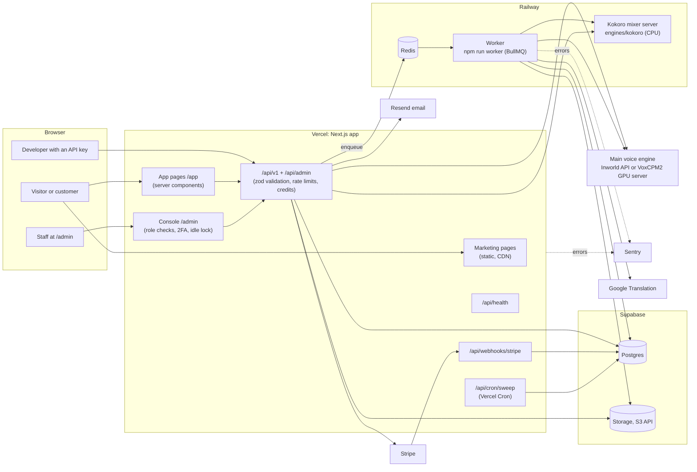

# Mimix architecture

One Next.js app serves the marketing site, the signed-in app, the staff console and the public API. Long work runs in a separate worker. Every outside service sits behind an interface with a local stand-in, chosen by environment variables.

## Request path

1. **Pages.** Marketing pages are rendered at build time. App and console pages are server components that read the session (Better Auth cookie) and the workspace. The console checks the staff role and permission on every page (`src/server/admin/guard.ts`).
2. **API.** Every `/api/v1` route goes through `apiAuth` (`src/server/api/auth.ts`): an API key (`mmx_…`, stored as a sha256 hash, scoped and capped) or the session cookie. Cookie requests that write must come from our own origin. Bodies are validated with zod schemas shared with the UI (`src/lib/schemas`). A per-key or per-user rate limit lives in Postgres, so it holds across instances.
3. **Credits.** A generation reserves credits in one transaction before the engine is called and refunds them if the engine fails (`src/server/credits.ts`). An engine that can't do a task is refused with `501 engine_unsupported` before anything is charged.
4. **Jobs.** Long tasks (dubbing, Studio export, cloning, voice changer, isolator, speech to text, data export, mix then clone) are queued. Locally they run inline in the web process; in production `QUEUE_DRIVER=bullmq` sends them to Redis and the Railway worker runs them.
5. **Files.** Uploads go straight to storage with a signed URL. The server then reads the bytes, sniffs the real type from the file's first bytes (`file-type`), refuses anything that isn't an accepted audio or video format and checks the size against `src/config/uploads.ts`. Downloads use short-lived signed URLs.
6. **Billing.** Stripe Checkout and the billing portal are redirects. Stripe tells us what happened through signed webhooks, which set the plan and credits.
7. **Sweeps.** Every 10 minutes `/api/cron/sweep` (Vercel Cron, `vercel.json`; the Vercel Pro plan is needed for schedules shorter than daily) (and the worker every 60 s) retries webhooks, deletes stale uploads and expired exports, resets monthly credits and purges deleted accounts. Every sweep is idempotent.

## Voice engines

| Engine | What it does | Where it runs |
|---|---|---|
| `mock` | Voice-like sound, every feature, no account | In process (default) |
| `inworld` | Speech, streaming, instant cloning, voice design, speech to text | Inworld's API |
| `voxcpm` | Speech and cloning on our own GPU | `engines/voxcpm` Docker image |
| `kokoro` | Voice Mixer: blends 2–3 library voices, pitch and warmth | `engines/kokoro` Docker image on CPU |

`VOICE_ENGINE` picks the main engine and `MIXER_ENGINE` the mixer. With `MIX_CLONE_TO_MAIN=true`, a saved mix is rendered for about 30 seconds on Kokoro and cloned on the main engine (off until Inworld confirms its terms allow it).

## Data

Postgres holds users, sessions, workspaces, memberships, voices (with consent records and mix recipes), generations, credit ledger, uploads, jobs, API keys, webhooks, reports, feature flags, plan overrides and the audit log. The schema is `src/server/db/schema.ts`; migrations are in `drizzle/`. Audio and uploads are in storage under per-workspace prefixes.

## Environments

| | Local | Staging | Production |
|---|---|---|---|
| Web | `npm run dev` | Vercel, `staging` branch | Vercel, `main` |
| Database | PGlite on :5433 | Supabase project "mimix-staging" | Supabase project "mimix" |
| Billing | stripe-mock | Stripe test mode | Stripe live mode |
| Jobs | inline | Railway worker | Railway worker |
| Email | `.data/outbox` | Resend | Resend |

Set-up steps for each service, with every environment variable, are in [launch-checklist.md](launch-checklist.md). The API reference is [openapi.json](openapi.json) (also served at `/api/v1/openapi.json`).
